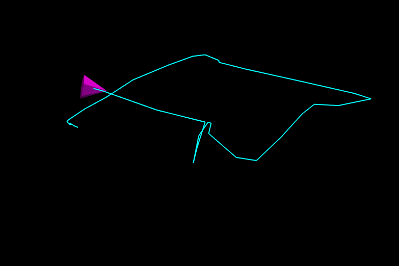
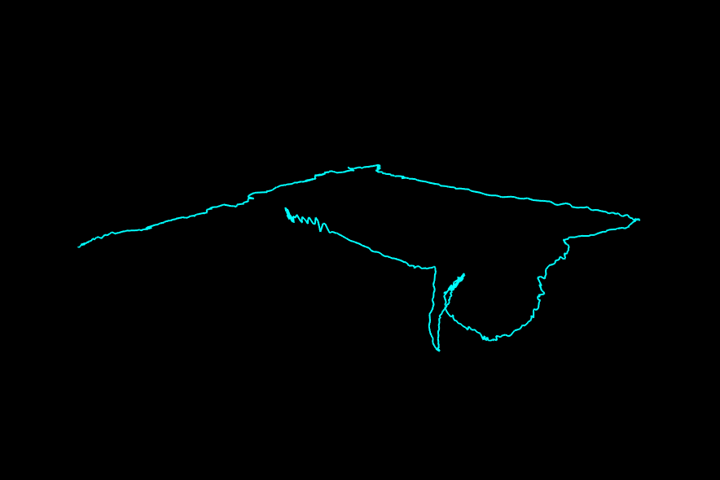

# Camera Part - ROS2 & Docker (PIE 2025-2026)

This project implements perception and spatial localization for a robotic arm using the **Stereolabs ZED Mini** camera. It includes object detection, coordinate frame transformation and a proof of concept for optical odometry.

This part of the project relies heavily on the zed_wrapper project: https://github.com/stereolabs/zed-ros2-wrapper
which offers a wide range of features worth exploring and using.

## Hardware Overview

see photos/camera.jpeg


## Prerequisites

### Hardware
* **Camera:** ZED Mini.
* **Cabling:** USB-A 3.0 ↔ USB-C cable (Warning: the USB-C connector is not reversible on this model; if the camera is not detected, flip the plug).
* **Computer:** NVIDIA GPU required.

### Software (Host)
* **NVIDIA drivers** installed.
* **CUDA:** v12.8.1 (used during development).
* **ZED SDK:** v5.1.1 (or any version > 5).
* **Docker & NVIDIA Container Toolkit.**

---

## Docker: Virtual Environment

To avoid dependency issues (ROS, CUDA, ZED SDK), we use **Docker**.

> **Build vs Run:** The "Build" step creates the image and takes about 5-10 min. The "Run" step starts the environment instantly.

### Display setup
To enable graphical display inside the container, run the command
```bash
xhost +local:root
```
before running it.

### Installation (Build)
If you need to rebuild the image (adapt to your versions):
```bash
cd zed-ros2-wrapper/docker
sudo ./desktop_build_dockerfile_from_sdk_ubuntu_and_cuda_version.sh ubuntu-22.04 cuda-12.8.1 zedsdk-5.1.1
```

### Launch (Run)
From the project root:
```bash
bash ./run_container
```
*The camera should turn on (blue LED). The logs will show detected objects in real time.*

---

## Usage and Basic Commands

### Accessing the container (new terminal)
The container is named `zed_camera` by default.
```bash
sudo docker exec -it zed_camera bash
```

### Docker & ROS utilities
* **List running containers:** `sudo docker container list`
* **Source the environment (if ROS does not respond):** `source install/setup.bash`
* **Camera configuration:** Parameters are located in `ros2_ws/src/zed_wrapper/config/common_stereo.yaml`.

---

## Project Architecture (ROS Nodes)

### 1. Data Processor Node
This is the core of the transformation logic.
* **Function:** Retrieves the arm position and the objects detected by the ZED SDK.
* **Computation:** Performs a change of basis to convert object coordinates from the "Camera" frame to the "Robot" frame.
* **Publishing:** Publishes these new coordinates on the shared ROS network.
* **Launch:** `ros2 launch data_processor processor_launch.py` (started automatically at startup).

### 2. Augmented Odometry Node (WIP)
Since the camera's internal odometry is noisy, we developed an optical odometry approach.
* **Proof of Concept:** Visualization available in `augmented_odometry/example_code`.
* **Expected results:**
    * *Cage trajectory:* 
    * *Computed trajectory:* 
* **Note:** Currently isolated in a dedicated `augmented_odometry` container due to Numpy version conflicts.

---

## PIE 2025-2026 Summary

### What works:
- [x] Stable Docker environment with all dependencies.
- [x] Hardware communication and object detection.
- [x] `data_processor` node (computing coordinates in the robot frame).

### In progress / To finish:
- [ ] Finalizing the `augmented_odometry` node.
- [ ] Fusing odometry data with a **Kalman Filter** using the robot's sensor information and/or the camera's odometry.

### Ideas for future students:
1.  **Data fusion:** Combine optical odometry with the arm's internal sensors.
2.  **Deep Learning:** Train your own object detection model specific to your environment.
3.  **Mapping:** Implement environment reconstruction (SLAM) so the robot "remembers" past obstacles.
4.  **Fun:** Have fun
---
*Carried out as part of the PIE 2025-2026 project.*
