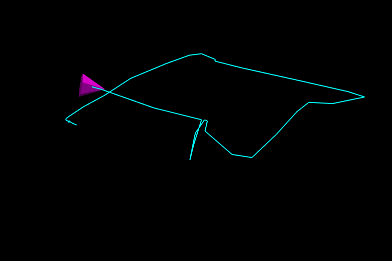
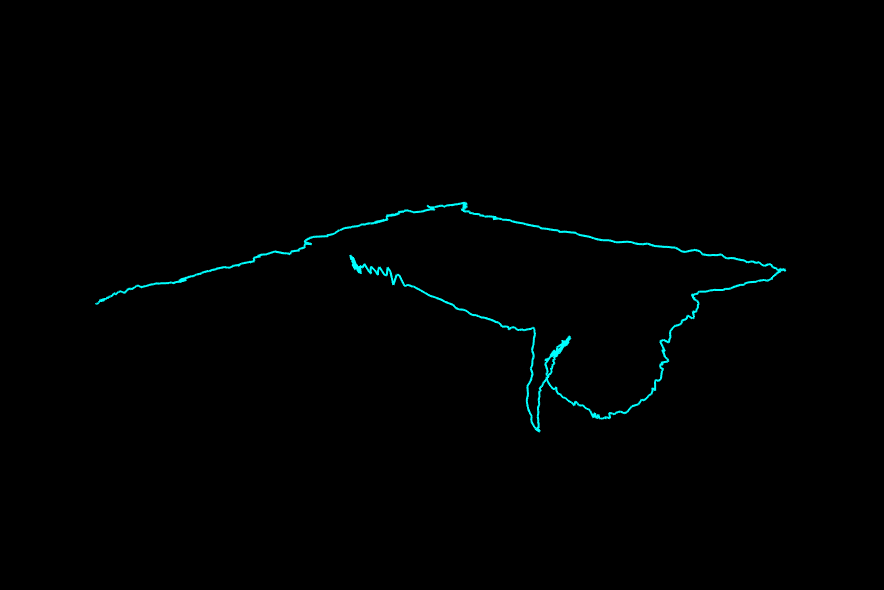

# Partie Camera - ROS2 & Docker (PIE 2025-2026)

Ce projet implémente la perception et la localisation spatiale pour un bras robotique en utilisant la caméra **Stereolabs ZED Mini**. Il intègre la détection d'objets, le changement de base de coordonnées et une preuve de concept pour l'odométrie optique.

Cette partie du projet s'appuie fortement sur le projet zed_wrapper : https://github.com/stereolabs/zed-ros2-wrapper
qui possede une multitude de fonctionalites, a explorer et a utiliser. 

## Aperçu du Matériel

cf photos/camera.jpeg


## Prérequis

### Hardware
* **Caméra :** ZED Mini.
* **Connectique :** Câble USB-A 3.0 ↔ USB-C (Attention : le connecteur USB-C n'est pas réversible sur ce modèle, si la caméra n'est pas détectée, retournez la prise).
* **Ordinateur :** GPU NVIDIA necessaire.

### Software (Hôte)
* **Pilotes NVIDIA** installés.
* **CUDA :** v12.8.1 (utilisée lors du développement).
* **ZED SDK :** v5.1.1 (ou toute version > 5).
* **Docker & NVIDIA Container Toolkit.**

---

## Docker : Environnement Virtuel

Pour éviter les problemes de dépendances (ROS, CUDA, SDK ZED), nous utilisons **Docker**.

> **Build vs Run :** Le "Build" (construction) crée l'image et prend environ 5-10 min. Le "Run" lance l'environnement instantanément.

### Préparation de l'affichage
Pour permettre l'affichage graphique dans le container, il faut executer la commande
```bash
xhost +local:root
```
avant de le run. 

### Installation (Build)
Si vous devez reconstruire l'image (à adapter selon vos versions) :
```bash
cd zed-ros2-wrapper/docker
sudo ./desktop_build_dockerfile_from_sdk_ubuntu_and_cuda_version.sh ubuntu-22.04 cuda-12.8.1 zedsdk-5.1.1
```

### Lancement (Run)
Placez-vous à la racine du projet :
```bash
bash ./run_container
```
*La caméra devrait s'allumer (LED bleue). Les logs afficheront les objets détectés en temps réel.*

---

## Utilisation et Commandes de base

### Accéder au container (nouveau terminal)
Le container est nommé par défaut `zed_camera`.
```bash
sudo docker exec -it zed_camera bash
```

### Utilitaires Docker & ROS
* **Lister les containers actifs :** `sudo docker container list`
* **Sourcer l'environnement (si ROS ne répond pas) :** `source install/setup.bash`
* **Configuration caméra :** Les paramètres se trouvent dans `ros2_ws/src/zed_wrapper/config/common_stereo.yaml`.

---

## Architecture du Projet (Nodes ROS)

### 1. Data Processor Node
C'est le cœur de la logique de transformation.
* **Fonction :** Récupère la position du bras et les objets détectés par le SDK ZED.
* **Calcul :** Effectue un changement de base pour convertir les coordonnées des objets du référentiel "Caméra" vers le référentiel "Robot".
* **Publication :** renvoie ces nouvelles coordonnes sur le ros commun.
* **Lancement :** `ros2 launch data_processor processor_launch.py` (lancé automatiquement au démarrage).

### 2. Augmented Odometry Node (WIP)
L'odométrie interne de la caméra étant bruitée, nous avons développé une approche d'odométrie optique.
* **Preuve de Concept :** Visualisation disponible dans `augmented_odometry/example_code`.
* **Résultats attendus :**
    * *Trajectoire Cage :* 
    * *Trajectoire Calculée :* 
* **Note :** Actuellement isolée dans un container `augmented_odometry` spécifique à cause de conflits de versions Numpy.

---

## Bilan PIE 2025-2026

### Ce qui fonctionne :
- [x] Environnement Docker stable avec toutes les dépendances.
- [x] Communication hardware et détection d'objets.
- [x] Node `data_processor` (calcul des coordonnées dans la base robot).

### En cours / À finir :
- [ ] Finalisation de la node `augmented_odometry`.
- [ ] Fusion des données d'odométrie via un **Filtre de Kalman** avec les informations des capteurs du robot et/ou celles de l'odometrie de la camera.

### Idées pour les futurs étudiants :
1.  **Fusion de données :** Combiner l'odométrie optique et les capteurs internes du bras.
2.  **Deep Learning :** Entraîner votre propre modèle de détection d'objets spécifique à votre environnement.
3.  **Mapping :** Implémenter une reconstruction d'environnement (SLAM) pour que le robot "se souvienne" des obstacles passés.
4.  **Fun :** S'amuser
---
*Réalisé dans le cadre du projet PIE 2025-2026.*
