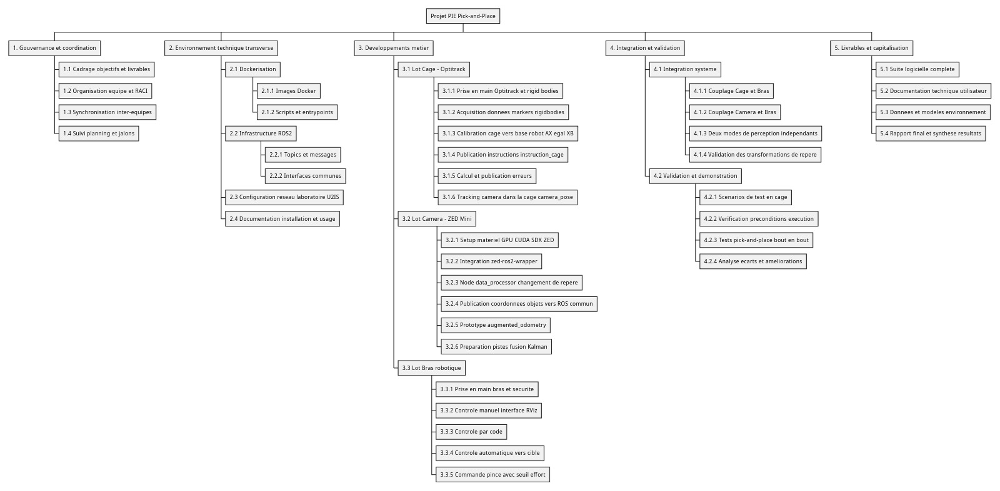
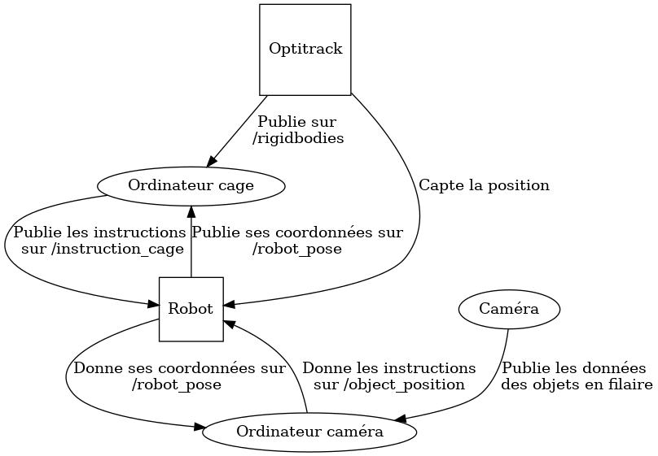

# PICK AND PLACE

## Specifications
The specifications provided by U2IS are as follows:
- Develop a control system for the robot arm.
- The system must be able to:
    - Move the arm towards a target object autonomously;
    - Grasp the object;
    - Move the object to a target location.
- The system must have two levels of autonomy:
    - Perform the actions above using complete information provided externally to the robot by the *Optitrack* system;
    - Perform the actions above using a camera mounted on the robot.

## Work Breakdown Structure

Here is the breakdown of the *pick and place* project into work packages.



## Technical choices
Several technical choices were made to meet hardware and time constraints.
### Repository organization
The repository contains the code of the *pick and place* project. It contains three folders holding the code developed by the PIE working groups:
- **Cage**: Contains the elements needed to process the data coming from the cage and the Optitrack;
- **Camera**: Contains the code needed to locate objects and give instructions to the robot;
- **Robot**: Contains the elements needed to operate the robot arm and publish its information.

Each folder has a `readme.md` that explains in detail how each part works.


Each project folder contains a Dockerfile that bundles all the tools needed to run the code, ensuring an isolated, reproducible and portable environment. The structure is similar to the one shown below:

```
projet/
├── Cage/
│   ├── Dockerfile
│   ├── .
│   └── script1.py
|   └── ...
├── Camera/
│   ├── Dockerfile
│   └── ...
```

### Overall structure
The project is therefore made up of different software and hardware parts. The different elements of the project communicate as follows:


### Choice of programming languages

The *camera* and *cage* parts are written in Python because it is a flexible language that makes it easy to process the data sent by the different devices. The part controlling the robot was developed in *MATLAB* because it provides more tools for developing the arm's control methods.


## Test procedures

There are two ways to test the validity of the methods developed:
- simulation;
- real-world testing.

### Simulation

To get familiar with the robot, the *robot* team first tested its algorithms using the simulation software provided by the manufacturer.

### Real-world conditions

A scene is built in the Optitrack cage using the cardboard boxes provided (see photo below).

To carry out a real-world test, i.e. by actually moving the robot, you need to:
- Detect the position of the gripper;
- Detect the position of the target object.

To do this, reflective markers are placed on the gripper and on the object to be grasped.

The cage operator makes sure that the objects are properly tracked by the Optitrack and that the error-measurement software is publishing on the `/errors` topic. This gives an accurate view of what is happening.

Then you simply test the desired systems. To test the cage calibration system, follow the procedure described in `Cage/readme.md`. To test the camera, refer to `Camera/readme.md`.

Note:
- It is always worthwhile to compute the instructions from the cage data. We managed to make them experimentally accurate, so they can serve as a reference.
