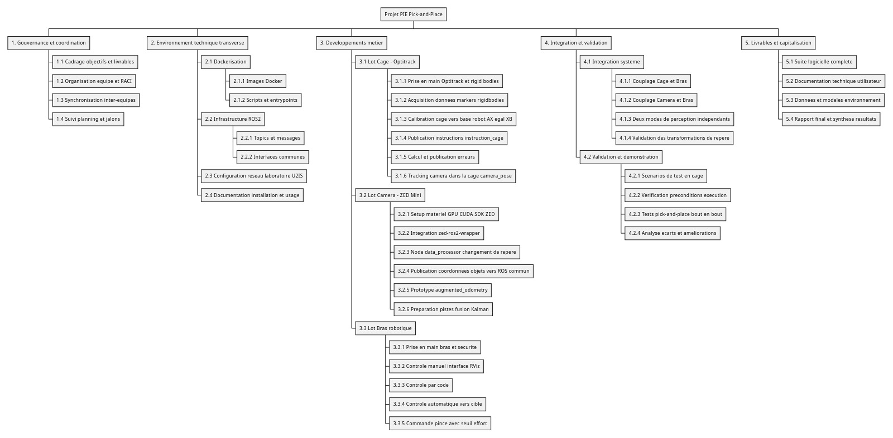
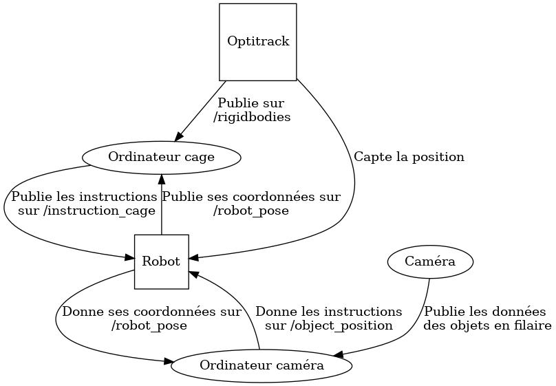

# PICK AND PLACE

## Cahier des charges
Le cahier des charges donné par l'U2IS est le suivant:
- Développer un système de contrôle du bras du robot qui:
- Le système doit permettre de:
    -  Déplacer le bras vers un objet cible de manière autonome;
    - Saisir l'objet;
    - De déplacer l'objet vers un cible.
- Le système doit avoir deux niveau d'autonomie:
    - Pouvoir effectuer les action ci-dessus à partir des inforation fournit de manière complètes et exterieurs au robot via le système *Optitrack*;
    - Pouvoir effectuer les action ci-dessus à partir d'une caméra embarquée sur le robot.

## Work Breakdown Structure

Voici le découpage en lot de travaille du projet *pick and place*.



## Choix techniques
Plusieurs choix techniques ont été fait afin de répondre à des contraintes de materiel et de temps.
### Organisation du dépôt
Le dépôt contient le code du projet *pick and place*. Il contient trois dossiers contenant les codes développés par les groupes de travails du PIE:
- **Cage**: Contient les éléments nécessaires pour traiter les données issues de la cage et de l'optitrack;
- **Caméra**: Contient le code nécessaire pour repérer les objets et données les instructions au robot;
- **Robot**: Contient les éléments nécessaires à la manipulation du bras du robot et à la publication de ses informations.

Chaque dossier possède un `readme.md` qui explique en détail le fonctionnement de chaque partie.


Chaque dossier du projet contient un Dockerfile permettant de regrouper tous les outils nécessaires à l'exécution du code, garantissant ainsi une environnement isolé, reproductible et portable. On a une structure similaire à ce qui est représenté ci-dessus:

```
projet/
├── Cage/
│   ├── Dockerfile
│   ├── .
│   └── script1.py
|   └── ...
├── Camera/
│   ├── Dockerfile
│   └── ...
```

### Structure générale
Le projet est donc consituté de différentes parties logicielles et physique. La communication des différentes éléments du projet se fait de la manière suivante:


### Choix des langages de programmation

La parties traitant de la *caméra* et de la *cage* sont codés en python car c'est un langage souple permettant facile de traiter les données envoyées par les différents media. La partie controlant le robot a été développé en *matlab* car il fournit plus d'outils pour développé les méthodes d'asservissement du bras. 


## Procédures de tests

Il y a deux façon de tester la validitée des méthodes produites:
- la simulation;
- le test en condition réel.

### Simulation

Pour prendre en main de robot, l'équipe *robot* à d'abord tester ses algorithme à partir du logiciel de simulation fourni par le constructeur.

### En condition réel

On construit une scène dans la cage de l'optitrack avec les carton mise à disposition (cf photo ci-dessous).

Pour effectué un test en condition réel, c'est-à-dire en bougeant le robot. Il faut:
- Détecter la position de la pince;
- Détecter la position de l'objet cible.

Pour cela on pose des billes réfléchissantes sur la pince et sur l'objet que l'on veut saisir.

L'opérateur de la cage s'assure que le objets sont bien traqués par l'optitrack et que le logiciel de mesure d'erreur publie bien sur le topic `/errors`. Cela permet d'avoir une visualisation précise de ce qui se passe.

Ensuite il suffit de tester les systèmes souhaités. Si on veut tester le système de calibration de la cage, il suffit de suivre la procédure décrite dans `Cage/readme.md`. Pour tester la caméra se référer à `Camera/readme.md`. 

remarque:
- Il est toujours interressant de calculé les instructions à partir des données de la cage. On a réussi a faire en sorte qu'elles soit juste expérimentalement, elles peuvent servir de référence.